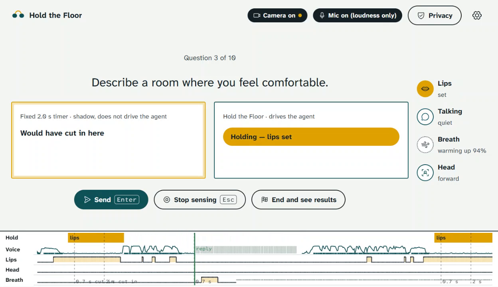
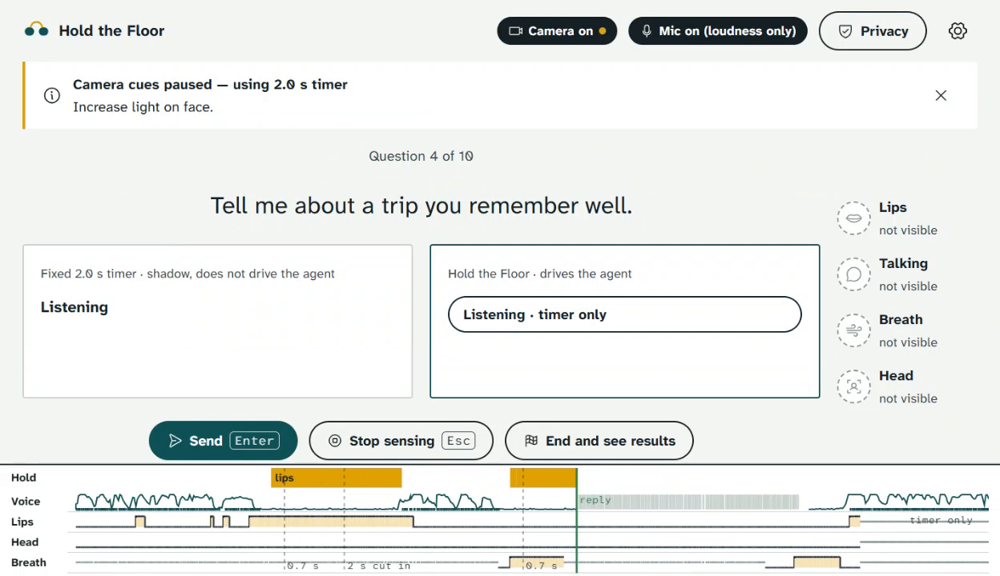
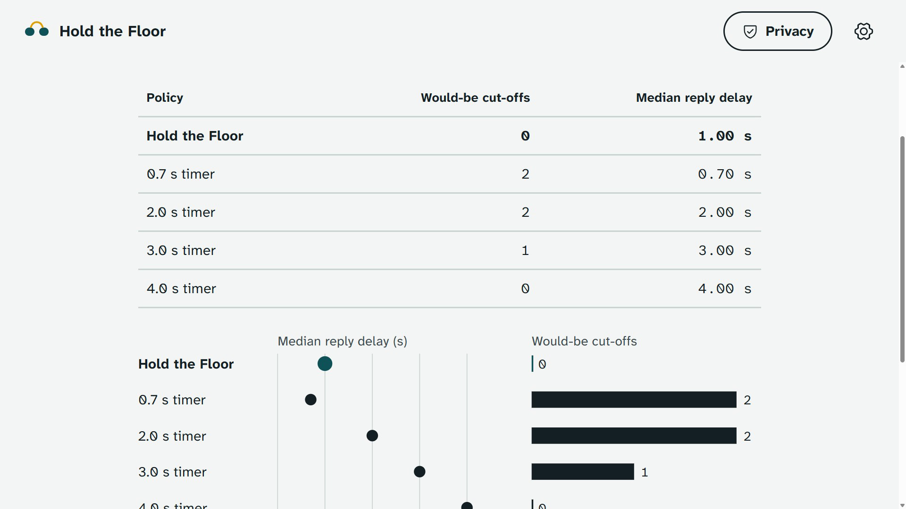

# Hold the Floor

**Voice AI that can see you are not finished yet.**

**Try it in your browser:** [hassan-2050.github.io/hold-the-floor](https://hassan-2050.github.io/hold-the-floor/) replays a recorded live session through the same engine (no install, camera or key).
**Videos:** [live demo](https://www.youtube.com/watch?v=4EyiS4MOHbE) (2:49) · [narrated walkthrough](https://www.youtube.com/watch?v=w9QwNYEWEj0) (3:03).

Voice assistants end your turn after a fixed silence, so they cut off people
who pause, search for words or stutter. During a silent stuttering block there
may be no sound at all, so an audio-only detector cannot tell you are still
speaking. Hold the Floor uses your own camera, through the
[SmartSpectra SDK](https://smartspectra.presagetech.com/docs), to see that you
are still mid-turn: lips pressed or set to speak, still talking, a breath in,
or your head turned while you think. It holds the agent's reply until those
cues relax, then replies quickly. It does not make everyone wait longer, which
is what a longer fixed timer does.

It is a conversation tool, not a therapy or medical tool. It does not detect,
rate or treat stuttering or any condition.

## Who it is for

People who stutter, people who pause to think, non-native speakers, older
adults, and builders of voice agents, through a local `end_of_turn` WebSocket API.

## What it does

- **Patient interviewer**: three neutral question sets of ten, spoken by your OS voice and shown in large text. It asks the next question only when your turn ends.
- **Turn arbiter**: a pure state machine (Listening → Candidate end → Holding → End of turn) that combines camera cues with microphone loudness. If the camera can't see you, it falls back to a fixed timer.
- **Floor ribbon and cue lights**: a 20-second timeline of your voice, lips, head and breath. An amber band shows each hold and the cue behind it. Dashed lines show where a fixed 2-second timer would have cut in.
- **Shadow timers and results**: fixed 0.7/2/3/4 s timers run on the same live input. The results compare would-be cut-offs and reply delay. Export as CSV or Markdown.
- **Comparison view**: the 2.0 s timer and Hold the Floor side by side, on the same session.
- **Oracle test mode**: the agent waits until you press Space, so every policy is scored against ground truth.
- **end_of_turn API**: a WebSocket on 127.0.0.1 with a random token. See [docs/WS-API.md](docs/WS-API.md).
- **Replay**: numbers-only recordings drive the same engine. The live demo session (5 answers) is bundled, so you can try the app **without a camera or key** and see the decisions the live run made.

## Screenshots

| Live: the 2 s timer would have cut in; Hold the Floor holds | Live: camera covered, cues paused | Results on the same session |
| --- | --- | --- |
|  |  |  |

## Requirements

- Windows x64, macOS on Apple Silicon, or Linux x64/ARM64 with glibc 2.35+ (the platforms the SmartSpectra Node SDK supports). Intel Macs are not supported.
- Node.js 20 or newer (24 LTS recommended).
- For live use: a webcam (≥ 25 fps; light in front of you), a microphone (headphones recommended), an internet connection (SmartSpectra checks its licence online), and a Presage API key from [physiology.presagetech.com](https://physiology.presagetech.com/auth/login).

## Setup from a fresh clone

```bash
git clone https://github.com/hassan-2050/hold-the-floor.git
cd hold-the-floor
npm install                 # pulls the SDK's native runtimes for all platforms (a few hundred MB)
npm run build
```

If Electron reports that it "failed to install correctly", run `node node_modules/electron/install.js` once.

Optional, for development: `cp .env.example .env` and set `SMARTSPECTRA_API_KEY=`. Setup then offers to import it. In normal use you paste the key in the Setup screen, and it is stored encrypted by your OS.

## Run

| What | Command |
| --- | --- |
| Live app | `npm start` |
| **Replay without camera or key** (for judges) | `npm run start:replay`, or press *Watch replay* on the Welcome screen |
| **Web replay page** (no install) | [hassan-2050.github.io/hold-the-floor](https://hassan-2050.github.io/hold-the-floor/). Build it with `npm run build:web` (`dist/web`); publish it to the `gh-pages` branch with `npm run deploy:web` |
| Live app with a troubleshooting log | `npm run start:debug` (writes event names, SDK codes and frame counts, no face data or audio, to `debug.log` in the app data folder) |
| Demo recording mode | `npm run demo`: records the app window, the agent's voice and your mic to your Videos folder, with a script window above the app (not recorded); `npm run demo:script` gives the script window without recording. See [docs/DEMO.md](docs/DEMO.md) |
| Development with hot reload | `npm run dev` |
| Unit tests (100) | `npm test` |
| End-to-end tests (10, no camera needed; one builds and plays the web page) | `npm run test:e2e` |
| Lint / typecheck | `npm run lint` / `npm run typecheck` |
| Ablation on a recording | `npm run ablation` (or `RECORDING=path.jsonl npm run ablation`) |
| Stage 1 SDK probe | `npm run probe`, then `npm run probe:analyze` (see [probe/README.md](probe/README.md)) |
| Score a saved session against threshold variants | `RECORDING=path.jsonl npm run tune` |
| Narrated walkthrough video from the replay | `scripts/walkthrough/` (Windows, ffmpeg); see [docs/DEMO.md](docs/DEMO.md) |

A live session goes: **Welcome → Consent → Setup** (key, camera and mic test, device-readiness check) **→ Calibration** (about 45 s) **→ Conversation → Results**.

Keys: **Enter** Send · **Esc / F8** stop camera and mic · **Space** "I am truly done" (oracle mode) · **Backspace** "I wasn't finished" (while the agent talks).

## How the arbiter works

```
AGENT ──agent done──▶ WAITING ──speech──▶ LISTENING
LISTENING ──silence ≥ 400 ms──▶ CANDIDATE_END
CANDIDATE_END ──any cue true ≥ 120 ms──▶ HOLDING
CANDIDATE_END / HOLDING ──no cue for 300 ms──▶ END_OF_TURN  (reply)
HOLDING ──speech──▶ LISTENING
any ──hard cap 8 s / Enter / Send──▶ END_OF_TURN
camera cues unavailable ──▶ fixed 2.0 s silence timer instead
```

| Cue | From | Rule |
| --- | --- | --- |
| Lips pressed | landmarks 0/17 (outer lips) ÷ eye distance | below a line 35% of the way from your calibrated press up to your rest height, never closer to rest than 3 MAD. Off for the session if the calibration press was within 0.05 of rest (Calibration then asks for a firmer press) |
| Lips set | landmarks 13/14 (inner lips) | parted beyond rest + max(3 MAD, 0.03) and held still ≥ 250 ms |
| Still talking | inner-lip movement, plus the SDK talking flag | mouth moved within the last 100–300 ms |
| Head turned | nose tip vs eye corners | yaw or pitch > 15° from your forward pose for ≥ 300 ms; alone it holds at most 2.5 s |
| Breathing in | SDK chest trace | rising faster than 0.35 resting breaths/s, during silence, only once the SDK marks breathing stable; alone at most 1.5 s |
| Voice | mic loudness every 20 ms | speech above your noise floor + up to 12 dB for ≥ 60 ms; silence below floor + 6 dB for ≥ 150 ms; ignored while the agent speaks |

Every number lives in [`config/thresholds.ts`](config/thresholds.ts), with the reason for its value. The core (`src/turn`, `src/features`, `src/audio/detector.ts`, `src/results`) imports no Electron, React or SDK code, and lint enforces this.

**SmartSpectra integration:** [`src/sensing/sdkClient.ts`](src/sensing/sdkClient.ts) (renderer), [`electron/main/readiness.ts`](electron/main/readiness.ts) (device readiness, main process), [`src/sensing/decode.ts`](src/sensing/decode.ts) (metrics → numbers). Everything learned about the SDK, including where it differs from the docs, is in [docs/SDK-NOTES.md](docs/SDK-NOTES.md).

## Consent and data handling

In short (full detail in [docs/PRIVACY.md](docs/PRIVACY.md)):

- Camera and microphone are separate opt-ins on a consent screen before anything starts. Esc or F8 turns both off at any time.
- Video is processed on your computer by the SmartSpectra SDK and is never saved or sent by the app. The microphone gives one loudness number per 20 ms; audio is never recorded. The Setup mic check holds a 3-second clip in memory for one playback, then discards it.
- SmartSpectra telemetry is **off**. The SDK still contacts Presage online to authenticate and check usage; there is no offline mode. The app makes no other network calls.
- Nothing is saved unless you press *Save numbers*. A saved session holds numbers only (26 face points, breathing trace, loudness, events), and you can delete each one, or all, from the app.
- Your API key is encrypted with your OS keychain and never logged or written to browser storage.
- Stored in: Windows `%APPDATA%\hold-the-floor\`, macOS `~/Library/Application Support/hold-the-floor/`, Linux `~/.config/hold-the-floor/`.

## Results so far

See [docs/RESULTS.md](docs/RESULTS.md). Stage 1 validated the SDK signals on real hardware: landmark order, roughly 30–60 ms delivery, breath polarity, and a framing requirement.

In the bundled live demo session (5 answers; *Watch replay* plays it), Hold the Floor replied after a median **1.00 s** with **no** would-be cut-offs. Fixed 0.7 s and 2 s timers on the same input would have cut in twice each, and a 3 s timer once; only a 4 s timer also avoided cut-offs, at a 4 s wait. Across three recorded takes (24 answers, scored by replaying the saved numbers), the shipped settings ended an answer early 3 times. That is one person with scripted pauses; the oracle self-test is still to come.

## Known limitations

- **Framing matters:** if your chest is out of view, the SDK sends no face landmarks, so all camera cues pause and the fixed timer takes over. Sit back with your shoulders and upper chest in view.
- **Frame rate:** the SDK needs ≥ 25 fps. Many laptop webcams drop below that in dim light. Light your face from the front, or choose 960×540 in Settings.
- **Breathing** is a supporting cue: it can bridge a short "pause to breathe" but cannot hold on its own for long.
- **Lips parted at rest** can make a "set" hold more likely. Calibration measures your own rest shape to reduce this.
- **The SDK talking flag** responded too slowly in testing, so mouth movement from the landmarks is used instead.
- **Agent voice reaching the mic:** use headphones. The mic is ignored while the agent speaks.
- **Not yet tested by people who stutter.** The scripted lip-press only approximates a block.

## Project layout

```
electron/main     window, API key (safeStorage), SmartSpectra IPC, readiness, WebSocket, TTS fallback, storage
electron/preload  SmartSpectra preload bridge + the app's narrow bridge (window.htf)
src/sensing       sdkClient (SDK), decode, quality gate, error mapping, recording, replay
src/features      landmark indices, geometry, lips, head pose, inhale, talking, calibration
src/audio         loudness AudioWorklet, mic source, voice-activity detector
src/turn          arbiter, shadow timers, engine, ribbon buffer, event types
src/agent         interviewer, voice, question sets
src/results       per-policy metrics, CSV/Markdown
src/app, src/screens, src/ui, src/state, src/styles   the interface
src/web           web replay page: browser stand-in for the desktop bridge, SDK stub
config/thresholds.ts   every tunable number
fixtures/sessions      bundled numbers-only recordings for replay (live demo session, Stage 1 protocol run)
probe/                 Stage 1 SDK probe and analyzer
scripts/               make-fixture (session → replay file); walkthrough/ (narrated video from the replay)
tests/unit, tests/e2e, tests/tools
docs/                  SDK-NOTES, PRIVACY, WS-API, RESULTS
```

## Credits

- [SmartSpectra SDK](https://smartspectra.presagetech.com/docs) by Presage Technologies (proprietary licence; installed from npm, not redistributed here).
- [Electron](https://www.electronjs.org/), [electron-vite](https://electron-vite.org/), [React](https://react.dev/), [Zustand](https://github.com/pmndrs/zustand), [ws](https://github.com/websockets/ws) (MIT).
- [Atkinson Hyperlegible Next and Mono](https://www.brailleinstitute.org/freefont/) by the Braille Institute (SIL OFL 1.1), via Fontsource.
- [Phosphor Icons](https://phosphoricons.com/) (MIT).
- Landmark indices follow the [MediaPipe Face Mesh](https://github.com/google-ai-edge/mediapipe) topology (Apache 2.0), as used by the SDK.

App code: MIT, see [LICENSE](LICENSE).
